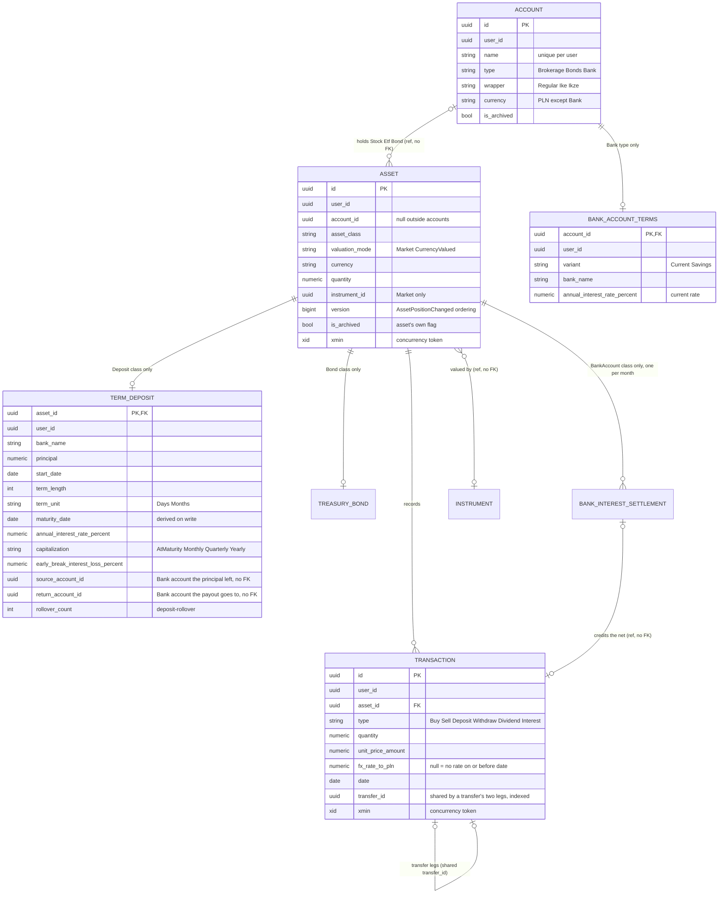
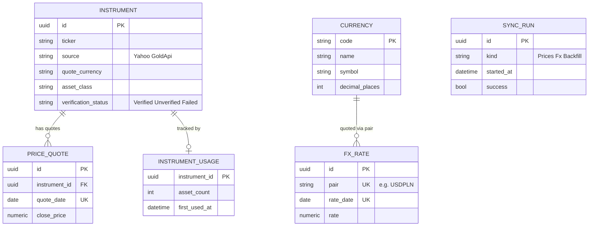
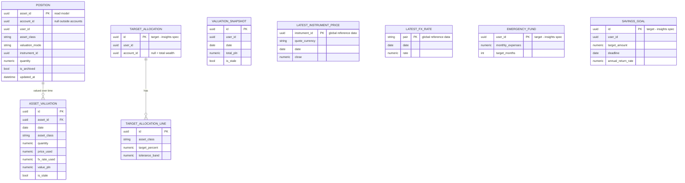

# Domain model

Target state (Część II.3). Items that don't exist on `master` yet are marked **(target — spec-0x)**; everything else is already true today. Cross-service references are marked "ref, no FK" — see the rule at the bottom.

## Asset classes and valuation modes

`AssetClass`: `Cash = 0`, `Deposit = 1`, `Stock = 2`, `Etf = 3`, `Bond = 4`, `PreciousMetal = 6`, `BankAccount = 9` — explicit values, so the stored ints stay stable and removed members leave gaps.

`AssetValuationMode` — two modes, explicit on `Asset.ValuationMode` (`Market = 0`, `CurrencyValued = 2`):

| Mode | Shape | Default classes |
|---|---|---|
| **Market** | points at an `Instrument` (ticker + source); value = quantity × last price × FX rate | Stock, Etf, PreciousMetal |
| **Currency-valued** | no instrument; value = quantity × FX rate for the asset's own currency (rate = 1 for PLN, so no lookup at all) | Cash, Deposit, BankAccount, Bond |

The class → default-mode mapping is a default, not a hard constraint — Market stays available to every class; only "no instrument" is gated by class: a Market class needs an instrument, and a Currency-valued class takes none.

## Identity (`identity_db`)

| Entity | Fields | Notes |
|---|---|---|
| `User` | Identity + `DisplayName` | `BaseCurrency` removed **(target — spec-05)** — unused, PLN is the only base currency (ADR-008) |
| `RefreshToken` | token hash, expiry, revoked | unchanged |

## Portfolio (`portfolio_db`)

| Entity | Fields | Changes vs today |
|---|---|---|
| `Account` | `Id, UserId, Name, Type (Brokerage \| Bonds \| Bank), Wrapper (Regular \| Ike \| Ikze), Currency, IsArchived` | new (accounts-replace-portfolios), replaces `Portfolio`: unique `(UserId, Name)`, `Type` and `Wrapper` stored as strings and fixed at creation, `Currency` fixed too (PLN for Brokerage and Bonds, PLN/EUR/USD for Bank; a Bank account is always Regular, bank-accounts-replace-savings); every account owns one hidden money asset — class Cash in PLN, or class BankAccount in the account's currency for a Bank account (`AccountResponse.cashAssetId`, `cashBalance`); archiving needs every asset in it, its cash included, at quantity 0 (409 `Conflict.AccountNotEmpty`) and deleting needs no asset other than its cash and no cash transaction (409 `Conflict.AccountHasHistory`), removing the cash and publishing its `AssetRemoved` |
| `CashPlace` | `Id, UserId, Name, IsArchived` | new (cash-places), a physical place holding cash such as "Sejf": unique `(UserId, Name)`, one hidden Cash balance asset per currency (`Asset.CashPlaceId`, unique `(CashPlaceId, Currency)`), created with the place or by `AddCashPlaceCurrency`; archiving needs every balance at 0 (409 `Conflict.CashPlaceNotEmpty`) and deleting needs no transaction on any balance (409 `Conflict.CashPlaceHasHistory`), removing the balances and publishing their `AssetRemoved` |
| `AccountContributionLimit` | `Id, UserId, AccountId, Year, Amount` | new (accounts-ike-contribution-limit): the hand-entered yearly limit of an IKE/IKZE account, unique `(AccountId, Year)`, deleted with its account; no FK; display only — exceeding it never rejects a write |
| `Asset` | `Id, UserId, AccountId?, CashPlaceId?, AssetClass, ValuationMode, Name, Currency, Quantity, InstrumentId?, Version, IsArchived, xmin` | `ValuationMode` already explicit (M1.4); `TransactionCount` removed (spec-02); delete cascades to its transactions in the handler (spec-08); `Version` is the per-asset event-ordering counter `PositionEventPublisher` bumps (not `xmin`, which doesn't move on the archive/restore fan-out); `AccountId` is required for Stock/Etf (a Brokerage account) and Bond (a Bonds account) and forbidden for every other class, never changes after creation, and is a plain id inside `portfolio_db` with no FK; a Cash asset has exactly one of `AccountId` (an account's money) or `CashPlaceId` (a place's balance, unique with `Currency`); `IsArchived` is the asset's own archive flag, independent of its account's (asset-archive) |
| `Transaction` | `Id, UserId, AssetId, Type, Quantity, UnitPriceAmount, FxRateToPln?, AmountPln?, FeeAmount?, Date, TransferId?, xmin` | `FeeAmount` (numeric 18,2, PLN) only on a stock or ETF Buy/Sell and ≥ 0, null elsewhere; `AmountPln` (numeric 18,2) is the PLN amount really paid or received, without the fee, only on a Buy/Sell of a non-PLN Stock/Etf with quantity, unit price and amount above 0 (otherwise 400 `Validation.PlnAmountNotAllowed`) — when set, `FxRateToPln = round(AmountPln / (Quantity × UnitPriceAmount), 8)`, MarketData is not asked, and the account-cash leg is `AmountPln ± fee`; an update without it clears it and re-freezes the market rate; `FxRateToPln` is the `{Asset.Currency}PLN` rate frozen at write time — the latest MarketData rate on or before `Date`, `1` for PLN, `null` when MarketData has none that early (ADR-026), except a stock/ETF Buy/Sell, which is refused without a rate (400 `Validation.FxRateMissing`) because its cash leg cannot be sized, and a stock/ETF Dividend/Interest, which is `1` for every currency because its amount is PLN; `TransferId` (indexed, asset-transfers-deposit-funding) links the two legs of a transfer, `null` on an ordinary or detached transaction |
| `TermDeposit` | `AssetId (PK, FK → Asset), UserId, BankName?, Principal, StartDate, TermLength, TermUnit (Days \| Months), MaturityDate, AnnualInterestRatePercent, Capitalization (AtMaturity \| Monthly \| Quarterly \| Yearly), EarlyBreakInterestLossPercent, SourceAccountId, ReturnAccountId, SettledOn?, SettledGrossInterest?, SettledTax?, RolloverCount` | new (term-deposits): the terms of a Deposit-class asset, 1:1 with it and the one real FK in `portfolio_db` (cascade delete); `SourceAccountId` (the Bank account the principal left, fixed) and `ReturnAccountId` (the Bank account the payout goes to, editable until the payout) are plain ids, no FK; `MaturityDate` is derived on every write; the projection (`DepositInterestMath`: actual/365, gross per capitalisation period rounded half-away-from-zero to grosze, 19 % Belka tax per period rounded up — always, a deposit has no tax exemption, net compounded) and the `Active \| Due \| Settled \| PaidOut` status (Europe/Warsaw date; Settled wins over Due, PaidOut over Settled — a settled deposit with a `Withdraw` is paid out, deposit-payout-to-cash) are computed at read time, never stored; the three `Settled*` fields (term-deposits-settlement) record what the bank actually paid, set together by `SettleDeposit` and null until then; `RolloverCount` (deposit-rollover, default 0) counts the terms `RollOverDeposit` started, stored rather than derived from the transactions |
| `BankAccountTerms` | `AccountId (PK, FK → Account), UserId, Variant (Current \| Savings), BankName?, AnnualInterestRatePercent` | new (bank-accounts-replace-savings), replaces `SavingsAccount`: the terms of a Bank account, 1:1 with it and FK-cascaded like `TermDeposit`; `Variant` stored as a string; `AnnualInterestRatePercent` is the current rate (0–100, no history); the balance is the money asset's `Quantity`, moved only by its ordinary transactions and the account transfers |
| `TreasuryBond` | `AssetId (PK, FK → Asset), UserId, SeriesCode, Type (TreasuryBondType), PurchaseDate, BondCount, PurchasePricePerBond, FirstPeriodRatePercent, MarginPercent?, EarlyRedemptionFeePerBond, MaturityDate, SwappedFromAssetId?` | new (bond-purchase): the terms of a Bond-class asset — one purchase lot of a retail treasury bond — 1:1 with it and FK-cascaded like `TermDeposit`; `MaturityDate` is derived on every write by `BondSchedule`; the interest periods and the `Active \| InterestDue \| Matured \| Redeemed` status are computed at read time, never stored; the tax exemption is not stored on the bond — every tax computation uses the owning account's wrapper (`Wrapper != Regular` is exempt); `SwappedFromAssetId` (bond-maturity-swap) is the matured bond a swap bought it with — a plain id, no FK, cleared when that bond is removed |
| `BankInterestSettlement` | `Id, UserId, AssetId, PeriodStart, PeriodEnd, GrossInterest, Tax, TransactionId?` | one settled calendar month of a Bank account's interest — what the bank paid, fixed once stored, keyed by the account's money asset; unique `(AssetId, PeriodEnd)`; `TransactionId` is the system-managed `Deposit` crediting the net, `null` when the net is 0; no FK |
| `BondInterestSettlement` | `Id, UserId, AssetId, PeriodIndex, PeriodStart, PeriodEnd, RatePercent, BondCount, GrossInterest, Tax, CreditTransactionId?, TransferId?` | new (bond-interest-periods): one settled interest period of a treasury bond — the rate it used, fixed once stored; unique `(AssetId, PeriodIndex)`; `CreditTransactionId` is the system-managed `Deposit` on the bond (net for a coupon, gross when capitalised, `null` when 0) and `TransferId` the coupon's Bond → account cash transfer; no FK — `RemoveAsset` deletes it in the handler |
| `BondRedemption` | `Id, UserId, AssetId, Kind (Maturity \| Swap \| Early), Date, BondCount, CapitalisedInterest, DiscountIncome, AccruedInterest, Fee, Tax, Proceeds, CreditTransactionId?, ChargeTransactionId?, CashTransferId?, SwapTargetAssetId?, SwapTransferId?` | new (bond-maturity-swap): a bond holding redeemed whole at maturity, or k of its bonds before it (bond-early-redemption, kind `Early`, with the accrued interest and fee as totals for the k bonds; 0 for the other kinds), fixed once stored, indexed — not unique — on `AssetId`; the ids point at the discount credit, the tax charge, the Bond → account cash transfer (the swap's leftover), and for a swap the new bond and the Bond → Bond transfer; no FK — `RemoveAsset` deletes it in the handler |
| `WatchlistItem` | `Id, UserId, InstrumentId, AssetClass, Ticker, Name, Exchange?, QuoteCurrency, Note?, TargetPrice?, AddedAtUtc` | new (securities-watchlist): a Stock or Etf the user follows without holding; unique `(UserId, InstrumentId)`; the instrument fields are a snapshot taken at add, no FK to MarketData |

Every slice that mutates a position publishes `AssetPositionChanged` in the same transaction as the write (spec-02), carrying `AccountId?`; removal publishes `AssetRemoved` (deleting its transactions with it). Creating, renaming, archiving, restoring and deleting an account publish nothing: archive needs every asset in the account at quantity 0 (409 `Conflict.AccountNotEmpty`) and delete needs it empty (409 `Conflict.AccountHasHistory`), so Reporting never has to zero a container. An archived account is read-only: adding assets to it, updating or removing its assets, and recording, updating or deleting their transactions returns 409 `Conflict.AccountArchived` until it is restored; renaming or deleting the account itself stays allowed. An asset with no account only gets the asset-archived check. `AddAsset` (Stock/Etf) and `AddBond` take `accountId`: missing is 400 `Validation.AccountRequired`, a wrong type 400 `Validation.AccountTypeMismatch`, an account on any other class 400 `Validation.AccountNotAllowed`, an unknown or foreign account 404 and an archived one 409 `Conflict.AccountArchived`. `ListAssets` takes an optional `accountId` filter.

A single asset of any class can be archived and restored the same way (asset-archive): `POST /api/portfolio/assets/{id}/archive` and `.../restore` flip `Asset.IsArchived` and publish one `AssetPositionChanged` carrying it (no new event type), idempotently — a call finding the asset already in the target state returns 200 and publishes nothing. An archived asset is read-only: updating it, recording, updating or deleting its transactions, and updating, settling or paying out a deposit — returns 409 `Conflict.AssetArchived`. The account check runs first (an archived asset inside an archived account answers `Conflict.AccountArchived`), both after the tenancy lookup. Removing an archived asset stays allowed. It keeps its transactions and terms, is not a transfer candidate or counterpart, and drops out of net worth from the archive date — earlier snapshots stay, and a restore brings it back. The two flags are independent: restoring an account leaves an asset archived on its own archived. The lists still return archived assets with `isArchived`; the client hides them behind "Show archived".

A Deposit-class asset is a term deposit, created and edited only through the deposit slices (`AddDeposit`, `UpdateDeposit`): they write the `Asset`, its `TermDeposit` and a system-managed opening `Deposit` transaction (principal, start date, unit price 1) together. A deposit is always opened from a Bank account: `AddDeposit` takes a required `sourceAccountId` (the user's unarchived Bank account: 404 unknown or foreign, 400 `Validation.BankAccountRequired` for another type, 409 `Conflict.AccountArchived`), the deposit takes its currency, and the opening `Deposit` is the In leg of a bank money → Deposit transfer (a negative balance on any day is 400 `Validation.InsufficientFunds`). `returnAccountId?` defaults to the source and must be an unarchived Bank account in the same currency (400 `Validation.BankAccountRequired` / `Validation.TransferCurrencyMismatch`); `UpdateDeposit` may change it until the payout, never the source. The tax is always `BelkaTax`; there is no exemption. A Bank account that is the return account of a deposit not yet paid out cannot be archived or deleted (409 `Conflict.AccountHasOpenDeposit`). `UpdateDeposit` rewrites that opening transaction and the bank leg instead of adding a correction; `RemoveAsset` deletes the `TermDeposit` with the asset. `SettleDeposit` (term-deposits-settlement) settles a Due deposit: it stores the settlement fields and, when the net interest (gross − tax) is above 0, adds a second system-managed `Deposit` transaction of it on the settlement date, so the quantity becomes principal + net and the money stays in the deposit. A payout moves that whole balance to the return account's money asset as a Deposit → BankAccount transfer — at settlement through `SettleDeposit`'s `payOut` flag (on `settledOn`, in the same save), or later through `PayOutDeposit` (`{ date }`, `settledOn ≤ date ≤ today`) — and the deposit is `PaidOut`, with `paidOutOn` and `paidOutToAccountName` (null once the destination was removed and its leg detached) on `GetDeposit`/`ListDeposits`; those also carry `sourceAccountId/Name` and `returnAccountId/Name`, and `ListDeposits?accountId=` returns the deposits an account funds or receives. `RollOverDeposit` (deposit-rollover) starts a Due or Settled (not paid-out) deposit's next term on the same asset: from Due it settles it in the same save, crediting the net interest on the old maturity date; from Settled it reuses the stored settlement and writes no transaction. Either way the new principal is the whole balance (old principal + that term's net), the new start date the old maturity date — however late the rollover — and the maturity date is recomputed from the unchanged term; only the rate changes. It clears the three `Settled*` fields and increments `RolloverCount`, so the next term is `Active`, or `Due` at once when its maturity date is already past. Each rollover overwrites the previous term; its net interest stays as its credit transaction. Once rolled over, `UpdateDeposit` keeps the principal and start date fixed (409 `Conflict.DepositRolledOver`) and never rewrites a transaction; every other term stays editable.

A Bond-class asset is a retail treasury bond holding (bond-purchase): one purchase of one series, created and edited only through the bond slices (`AddBond`, `UpdateBond`; `AddAsset`/`UpdateAsset` reject class Bond or a change to or from it with 400 `Validation.UseBondEndpoints`). It is Currency-valued and always PLN. `AddBond` writes the `Asset`, its `TreasuryBond` and a system-managed opening `Deposit` of `bondCount × purchasePricePerBond` on the purchase date (unit price 1, FX 1) in one save — that Deposit is the In leg of a transfer from the bond's account cash (the request names no source), so a purchase making the cash negative on any day is 400 `Validation.InsufficientFunds` — and publishes `AssetPositionChanged` for every touched asset; `UpdateBond` rewrites the opening transaction and the cash leg in place under the same check (a swap-born bond's opening legs stay fixed). Its transactions are system-managed: record, update or delete through the transaction endpoints is 409 `Conflict.BondTransactionsManaged`. `BondSchedule` derives the maturity (OTS 3 months, ROR 1 year, DOR 2, TOS 3, COI 4, ROS 6, EDO 10, ROD 12 years) and the interest periods — monthly for ROR/DOR, one 3-month period for OTS, yearly otherwise — each ending at `purchaseDate.AddMonths(k)` or `AddYears(k)`, never chained. `GetBond`/`ListBonds` (by maturity date, then name; assets of archived accounts left out) return the terms, the account (`accountId`, `accountName`, `taxWrapper`), `nominalValue` (count × 100), `bookValue` (`Asset.Quantity`, starting at cost) and, on the Europe/Warsaw date, each period as `Upcoming` or `Due` (ended) and the status: `Matured` from the maturity date, `InterestDue` while a period has ended, else `Active`. `RemoveAsset` deletes the `TreasuryBond` through the FK cascade.

A bond's interest (bond-interest-periods) is settled period by period, in order. `BondInterestMath` computes the per-bond gross of period k, rounded half away from zero to grosze: OTS `100 × r/100 × days/365` over the period's actual length; ROR and DOR `100 × r/100 / 12`; COI `100 × r/100`; TOS, EDO, ROS and ROD `C_k − C_{k−1}` with `C_k = round(100 × Π_{i≤k}(1 + r_i/100))` over the unrounded product and `C_0 = 100`, so the period-k rate needs the stored rates of periods 1…k−1. The period total is that × the bond count; the tax is `BelkaTax` for a coupon (ROR, DOR, COI) and 0 for capitalised interest, which is taxed at redemption. Period 1 and every period of a fixed-rate type (OTS, TOS) use `FirstPeriodRatePercent`; every other period takes the MF rate sent with the request. `SettleBondInterest` takes the next k ≥ 1 unsettled, ended periods (Europe/Warsaw) in one request and, in one save, stores a settlement per period plus a system-managed `Deposit` dated the period end — for a coupon the net, moved straight out by a Bond → account cash transfer to the bond's own account cash (the request names no destination), so the bond keeps its value; when capitalised the gross, so the bond's book value grows — and publishes `AssetPositionChanged` once per touched asset. `PreviewBondInterest` runs the same validation and math and stores nothing. `UndoBondInterestSettlement` deletes the latest settlement with its credit and, for a coupon, both transfer legs; a coupon already spent from the account cash makes the undo 400 `Validation.InsufficientFunds`. `BondResponse` marks a settled period `Settled` with its rate, count, gross and tax and carries `duePeriodCount` (ended, unsettled periods) and `lastSettlement`; `InterestDue` means a `Due` period is unsettled; `TransactionResponse` carries a credit's `bondInterestPeriodIndex`.

A matured bond (bond-maturity-swap) is redeemed whole, everything dated its maturity date however late it is recorded, once every period is settled. The pure `BondRedemptionMath` takes, per bond, the capitalised interest `c` (the sum of the settled per-bond credits, i.e. `C_n − 100` for TOS/EDO/ROS/ROD and the one period for OTS; 0 for a coupon type, whose coupons were already paid) and the discount `δ = 100 − purchasePricePerBond`; for the holding's k bonds `taxable = k × (c + δ)`, `tax = BelkaTax(taxable)` and `proceeds = k × (100 + c) − tax`. `RedeemBond` writes, in one save, a system-managed `Deposit` of `k × δ` (when above 0), a system-managed `Withdraw` of the tax (when above 0) and a Bond → account cash transfer of the proceeds to the bond's own account cash, so the balance goes cost + capitalised → + discount → − tax → − proceeds = 0; it stores a `Maturity` redemption and publishes both assets. `GetBondRedemptionPreview` runs the same checks and math and stores nothing. `SwapBond` redeems the old holding whole the same way (kind `Swap`) and spends `bondCount × swapPricePerBond` of the proceeds on a new Bond asset in the same account (so an IKE lot stays IKE) — purchase date the old maturity date, `SwappedFromAssetId` the old asset, its opening `Deposit` the In leg of a Bond → Bond transfer — and moves a leftover (the unswapped bonds included) Bond → account cash; a swap costing more than the proceeds spends all of them on the Bond → Bond transfer and takes the shortfall from the account cash by an account cash → new bond transfer dated the old maturity date (400 `Validation.InsufficientFunds` when the cash cannot cover it on any day); the old bond, the new bond and the account cash each publish once in the same save. The new bond's own discount is taxed at its redemption, not at the swap. `BondResponse` carries `redemptions[]` (kind, date, count, accrued interest, fee, tax, proceeds, the swap target name, null once removed), `swappedFrom` and the status `Redeemed`.

Before maturity (bond-early-redemption), `RedeemBondEarly` redeems k of the holding's n bonds on a date d inside period k′ — `a` days from the period start, `ACT` days in the period. The pure `BondRedemptionMath.EarlyPerBond` follows the MF issue letters' `WP = N × Π(1 + r_i) × (1 + r_k′ × a/ACT)`: the interest `i`, rounded half away from zero to 2 dp, is `round(C*_{k′−1} × (1 + r/100 × a/ACT)) − 100` for TOS/EDO/ROS/ROD (`C*` the unrounded compound value, rounded to grosze at each period end for TOS only), `round(100 × r/100 / 12 × a/ACT)` for ROR/DOR, `round(100 × r/100 × a/ACT)` for COI and 0 for OTS. The fee `f` is `min(EarlyRedemptionFeePerBond, i)` for a capitalising type and in period 1 of a coupon type, the full fee from period 2 of ROR/DOR/COI (their earlier coupons were already paid, so the proceeds may fall below 100), and 0 for OTS. For k bonds `taxable = max(0, k × (i − f + δ))`, `tax = BelkaTax(taxable)` and `proceeds = k × (100 + i − f) − tax`. In one save, all dated d: a system-managed `Deposit` of `k × (i − c_{k′−1} + δ)` (when above 0; `c` the per-bond interest already capitalised, 0 for a coupon type), a system-managed `Withdraw` of `k × f + tax` (when above 0) and a Bond → account cash transfer of the proceeds to the bond's own account cash; the `Early` row is stored, `BondCount` drops by k and both assets publish. `GetBondEarlyRedemptionPreview` (`?date=&bondCount=&runningPeriodRatePercent=`) runs the same checks and math and stores nothing. Later settlements, the maturity redemption and the swap use the remaining count.

Bond valuation (bond-value-today): `GetBond`/`ListBonds` carry `estimate` (`grossValue`, `netValue`, `asOf`, PLN totals for the held count) or `null` with `estimateUnavailableReason` — display-only, never stored, never published; Reporting keeps valuing a bond at its book value. The pure `BondValuation.Today` takes the rates of periods 1…k (k the running period; every period once matured): a settled period's stored rate, `FirstPeriodRatePercent` for period 1 and fixed types, else MarketData's catalog rate — one missing gives `RateMissing`. Gross per bond, rounded once to 2 dp and times the count: `100 + i` with `i` from `BondRedemptionMath.EarlyPerBond` for TOS/EDO/ROS/ROD (`100 × r/100 × a/365` for OTS), `100 + accrued + Σ unsettled ended coupons` for ROR/DOR/COI, and the maturity value once matured. Net: `BondRedemptionMath.Early` for the whole count on today (`AtMaturity` once matured) plus each unsettled coupon's net of `BondInterestMath.Settle`. The handlers call MarketData's `POST /internal/bond-series/rates-batch` once with the distinct series that need a catalog rate and skip it when every rate is local; MarketData unreachable leaves those bonds' estimate `null` with `MarketDataUnavailable` and the read still answers 200 (ADR-028). A redeemed bond has no estimate.

Securities list (securities-holdings-page): `ListSecurities` (`GET /api/portfolio/securities?assetClass=Stock|Etf`, any other class 400 `Validation.UnsupportedAssetClass`) lists the user's Market-mode Stock or Etf assets whose asset and account are both unarchived, by account name then asset name, each with its `accountId` and `accountName`. The pure `SecurityCostBasis.Compute` replays the transactions like `TransactionQuantityCalculator` (by date, same-day inflows first) and keeps a weighted-average cost: a Buy adds `q × unitPrice + fee / FxRateToPln` to `costQuote` and the cash leg's amount, `(AmountPln ?? round(q × unitPrice × FxRateToPln, 2)) + fee`, to `costPln` (one null rate makes `costPln` null from then on); Sell/Withdraw remove `q / quantity` of both so the average is unchanged (a Sell's fee does not change the cost); a position back at 0 resets both to 0; Dividend and Interest are ignored; `averageBuyPrice = costQuote / quantity` and `averageBuyPricePln = costPln / quantity` to 4 dp (the latter null when `costPln` is null). The handler calls MarketData once for the instruments (`POST /internal/instruments/batch`: ticker, name, exchange, quote currency, last close ≤ today and its date) and once for the `{CUR}PLN` rates, then returns per holding `valuePln = round(quantity × lastPrice × rate, 2)`, `unrealizedPl = round(quantity × lastPrice − costQuote, 2)` in the quote currency, `unrealizedPlPercent` (null at cost 0) and `unrealizedPlPln = valuePln − round(costPln, 2)` (null when either side is null); `priceUnavailableReason` is `NoQuote`, `FxRateMissing` or `MarketDataUnavailable` (both lookups failed — the list still answers 200 with `ticker`, `exchange` and every price field null). `totals` sum each field over the holdings where it is not null. Nothing is stored or published; Reporting values positions from its own `Latest*` tables, so the page and net worth can differ by one sync (ADR-031).

Watchlist (securities-watchlist): `/api/portfolio/watchlist` adds (`POST {instrumentId, note?, targetPrice?}`, 201), lists (`GET ?assetClass=Stock|Etf`, any other class 400 `Validation.UnsupportedAssetClass`, ordered by ticker then name), gets, replaces `note` and `targetPrice` (`PUT {id}`, null clears) and deletes a `WatchlistItem`. Adding checks the instrument through `GET /internal/instruments/{id}` with `AddAsset`'s errors, accepts only Stock or Etf, stores its ticker, name, exchange, class and quote currency, trims the note (empty becomes null, over 500 characters 400) and needs a `targetPrice` above 0 in the quote currency; a second add of the same instrument is 409 `Conflict.InstrumentAlreadyWatched`. A read calls MarketData once for the instruments (`POST /internal/instruments/batch`, now with `previousClose` and `previousCloseDate`, the latest close strictly before the last one) and once for the `{CUR}PLN` rates, then returns per item `dailyChange = lastPrice − previousClose`, `dailyChangePercent = round(dailyChange / previousClose × 100, 2)`, `lastPricePln = round(lastPrice × rate, 2)`, `targetDistancePercent = round((lastPrice − targetPrice) / targetPrice × 100, 2)` (negative below the target) and `atOrBelowTarget = lastPrice ≤ targetPrice` (false when either is null); a field whose input is null is null, and `priceUnavailableReason` is `NoQuote`, `FxRateMissing` or `MarketDataUnavailable` (the read still answers 200 with the snapshot fields). `holdings` lists the user's Market assets of the instrument whose asset and account are both unarchived, quantity 0 included, by account name then asset name, and `heldQuantity` sums them. Add and remove publish `WatchlistItemAdded` and `WatchlistItemRemoved` through the outbox; update publishes nothing (ADR-035).

An account's cash (accounts-account-cash) is a PLN, Currency-valued Cash asset with `AccountId` set, named after the account: `CreateAccount` writes it in the same save as the account and publishes its `AssetPositionChanged`; renaming the account renames it and publishes nothing; `ListAssets` and the cash-place transfer candidates leave it out. It is system-managed — `UpdateAsset`, `RemoveAsset`, `ArchiveAsset` and `RestoreAsset` on it are 409 `Conflict.AccountCashManaged`, and `AddAsset` rejects every Cash asset (400 `Validation.UseCashPlaceEndpoints`). Money enters and leaves through ordinary `Deposit`/`Withdraw` transactions on it (unit price 1, date ≤ today, editable and deletable) and moves between two accounts through the manual transfer route below; its balance is `Asset.Quantity`, so no new event or Reporting position kind exists. Any write that makes its replay negative on any day is 400 `Validation.InsufficientFunds` (`AccountCash.OversellError`), in place of `OversellsPosition`. An archived account's cash is read-only (409 `Conflict.AccountArchived`). Reporting's `byAccount` entries carry `cashPln`, the sum of the account's Cash-class lines.

A cash place (cash-places) is physical cash such as "Sejf" with 2 000 zł and 300 USD, under `/api/portfolio/cash-places`. `CreateCashPlace` (`{name, currencies[]}`, PLN alone by default, 201) writes the `CashPlace`, one Cash balance asset per currency (named after the place, `AccountId` null, `CashPlaceId` set) and each balance's `AssetPositionChanged` in one save, so Reporting values every balance as a Cash position in its own currency under "Poza rachunkami" with no Reporting change; a duplicate name is 409 `Conflict.DuplicateName`. `AddCashPlaceCurrency` adds a balance (409 `Conflict.DuplicateCurrency`), `UpdateCashPlace` renames the place and its balances and publishes nothing, `ArchiveCashPlace`/`RestoreCashPlace` are idempotent, and `DeleteCashPlace` publishes `AssetRemoved` per balance. `ListCashPlaces` (archived included) and `GetCashPlace` return per balance `currency, cashAssetId, balance, valuePln?`, the place's `valuePln?` and, for the list, `totals[]`, `totalValuePln?` and `fxUnavailable`: `valuePln = round(balance × rate, 2)` with the latest `{CUR}PLN` rate from one `POST /internal/fx/latest-batch` call for the held non-PLN currencies (1 for PLN, 0 for an empty balance), failing soft — MarketData unreachable leaves the foreign values null with `fxUnavailable` and the read still 200 (ADR-036). The balances are system-managed: `UpdateAsset`/`RemoveAsset`/`ArchiveAsset`/`RestoreAsset` on one are 409 `Conflict.CashPlaceManaged`, an archived place is read-only (any transaction or transfer on a balance is 409 `Conflict.CashPlaceArchived`), and money enters and leaves through ordinary Deposit/Withdraw transactions or the bank ↔ place transfer route; a write that makes a balance's replay negative on any day is 400 `Validation.InsufficientFunds`. A metal's optional `cashAssetId` is a place's PLN balance; an account's cash there is 400 `Validation.InvalidTransferCounterpart`.

A BankAccount-class asset is the money of a Bank account: `CreateAccount` writes the `Account`, its `BankAccountTerms`, the asset and its `AssetPositionChanged` in one save, `UpdateAccount` changes the name and the terms (variant, bank, rate) and publishes nothing, and `AddAsset`/`UpdateAsset` reject the class (400 `Validation.UseAccountEndpoints`). Like an account's cash its transactions are ordinary Deposit/Withdraw, recorded, edited and deleted through the transaction endpoints, and the asset itself is system-managed (409 `Conflict.AccountCashManaged`).

A Bank account's interest is settled one calendar month at a time. The first period runs from the earliest transaction's date to that month's last day, each later one is the next calendar month, and a period has ended — is Due — from the day after its last day (Europe/Warsaw). `BankInterestMath` accrues it from the end-of-day balance `B(d)` (every Deposit minus every Withdraw dated on or before `d`, earlier credits included, so interest compounds monthly): gross = `round(Σ B(d) × rate / 100 / 365, 2)` half away from zero, once per period, with the current rate for every day (a rate change applies from the next unsettled period); the tax is always the Belka rule `BelkaTax`; net = gross − tax. The next due period is the first ended month after the latest settlement (or from the first period) with a projected gross above 0 — zero-interest months are skipped, never Due and never stored. The endpoints live under the account: `GET /api/portfolio/accounts/{id}/interest-preview` returns it with the count of such months; `POST .../interest-settlements` (with the period's end, so a stale dialog or a double submit is 409 `Conflict.BankInterestPeriodMismatch`) stores the settlement and, when the net is above 0, a system-managed `Deposit` of it dated the period end (FX frozen), and publishes `AssetPositionChanged` in one save; `DELETE .../interest-settlements/{settlementId}` deletes the latest settlement and its credit. A non-Bank account is 400 `Validation.InterestNotSupported`, an archived one 409 `Conflict.AccountArchived`. `AccountResponse.bank` carries `variant`, `bankName`, `annualInterestRatePercent`, `interestDue`, `duePeriodCount`, `lastSettlement` and `interestCreditedNet` (the sum of the stored settlements' net, in the account's currency), and `TransactionResponse` a credit's `bankInterestPeriodEnd`, all computed at read time.

A transfer (asset-transfers-deposit-funding) moves money between two of one user's assets as two linked transactions sharing a `TransferId`: a `Withdraw` on the source and a `Deposit` on the target, the same amount and date, unit price 1, each with its PLN rate frozen (ADR-026). The allowed routes live in `TransferRoutes` (BankAccount → Deposit for `AddDeposit`; Cash ↔ Bond, non-manual and only between a bond and its own account's cash — Cash → Bond for a purchase (`AddBond`, `UpdateBond`) and a swap's shortfall, Bond → Cash for a coupon, a redemption and a swap's leftover; Bond → Bond, entered only through `SwapBond`; Deposit → BankAccount for the payout; an account's money → another account's money, of any account type, and a Bank account's money ↔ a cash place balance (an ATM withdrawal, a bank deposit), both **manual**, decided on the assets by `TransferRoutes.IsCreatable(Asset, Asset)` — the same account, place → place or a place ↔ a Brokerage or Bonds account's cash is 400 `Validation.InvalidTransferCounterpart`, a stranger's source is 404, not editable, and `GET /api/portfolio/transfer-candidates?accountCash=true&currency=` lists the accounts' money and `?cashPlaces=true&currency=` the unarchived place balances in that currency), and each non-manual route enters through its own slice: `AddDeposit` makes the opening transaction the In leg of a BankAccount → Deposit transfer, and `UpdateDeposit` rewrites both legs when the principal or start date changes; `SettleDeposit` with `payOut` and `PayOutDeposit` write the deposit's Withdraw as the Out leg of a Deposit → BankAccount transfer. The entry point recomputes and publishes `AssetPositionChanged` for both assets in one save; a counterpart that is not the user's, the same asset, off-route, archived itself or in an archived account is 400 `Validation.InvalidTransferCounterpart`, one in another currency 400 `Validation.TransferCurrencyMismatch`, and a source whose running balance would drop below 0 is 400 `Validation.InsufficientFunds`. `ListTransactions` returns a leg's counterpart (asset, account name, direction), `GetDeposit`/`ListDeposits` the source and return accounts, and `GET /api/portfolio/transfer-candidates` the pick list. Replay orders same-day transactions inflows first, so a same-day top-up and transfer out never fail on the Guid order. The manual routes enter only through the generic `POST /api/portfolio/transfers` (`{sourceAssetId, targetAssetId, amount, date}`, date ≤ today, 201 with `transferId`) and `DELETE /api/portfolio/transfers/{transferId}` (both legs removed, both assets recomputed and published, a delete breaking the target's later history refused with 409 `Conflict.OversellsPosition`); both reject any non-manual route — create with 400 `Validation.InvalidTransferCounterpart`, delete with 409 `Conflict.TransferLegManaged` — and an archived account on either side is 409 `Conflict.AccountArchived`. A leg's `transfer` carries `transferId` and `manual`. A stock or ETF trade (accounts-brokerage-trades) is the one transfer whose security leg keeps its trade shape and always settles in the security's own account cash (PLN, never a cash place): `RecordTransaction` and `AddAsset`'s initial transaction write a Buy or Sell `(quantity, unitPrice)` with an optional PLN `feeAmount` and an account-cash leg of unit price 1 and FX 1, one `TransferId` — a Buy's a `Withdraw` of `round(quantity × unitPrice × r, 2) + fee`, a Sell's a `Deposit` of `round(quantity × unitPrice × r, 2) − fee` (a fee above the gross is 400 `Validation.FeeExceedsProceeds`), where `r` is the security leg's frozen `FxRateToPln` (a foreign security with no MarketData rate that early is 400 `Validation.FxRateMissing`). A Dividend or Interest is a net PLN amount: `quantity` is the amount, unit price 1, `FxRateToPln` 1 for every currency, paid as a `Deposit` of the same amount, at any position size. A `cashAssetId` on a Stock/Etf is 400 `Validation.CashLinkNotAllowed` (precious metals keep it) and a `feeAmount` anywhere but a stock/ETF Buy/Sell is 400 `Validation.FeeNotAllowed`; Stock/Etf accept only Buy, Sell, Dividend and Interest. The routes Cash ↔ Stock and Cash ↔ Etf are non-manual and exist only between a security and its own account's cash, and `DirectionOf` treats Withdraw, Sell, Dividend and Interest as Out. `UpdateTransaction` and `DeleteTransaction` on the security leg change both legs and re-freeze the rate for the new date (a type change is 409 `Conflict.TransferLegManaged`, a security replay below 0 is 409 `Conflict.OversellsPosition`, a negative account cash on any day after record, update or delete is 400 `Validation.InsufficientFunds`); the cash leg itself is 409 `Conflict.TransferLegManaged` through the transaction endpoints.



## MarketData (`marketdata_db`)

| Entity | Fields | Role |
|---|---|---|
| `Currency` | `Code (PK), Name, Symbol, DecimalPlaces, DisplayOrder` | no `FallbackRateToPln`, no `IsPivot` (PLN is the fixed base). Seed: PLN, EUR, USD, GBP, CHF |
| `Instrument` | `Id, Ticker, Name, Source, QuoteCurrency, AssetClass, Exchange?, VerificationStatus, HistoryCoveredFrom?` | `HistoryCoveredFrom` is the earliest date `HistoryBackfillJob` has covered (the requested date, even when the source clamped it), null until the first backfill. `QuoteCurrency` is unconstrained (whatever the provider quotes), except a Stock/Etf takes it and `Exchange` (the configured name, e.g. GPW, Xetra; null for gold) from the `InstrumentSearch:Exchanges` entry matching its ticker suffix (ADR-030). Portfolio rejects a market asset whose class or currency differs from its instrument's |
| `PriceQuote` | `InstrumentId, Date, ClosePrice` — unique (instrument, date) | unchanged |
| `FxRate` | `Pair (e.g. USDPLN), Date, Rate` — unique (pair, date) | unchanged |
| `SyncRun` | + `Kind: Prices \| Fx \| Backfill \| BondCatalog` | one log shape for all four jobs |
| `InstrumentUsage` | `InstrumentId (PK), AssetCount, WatchCount, FirstUsedAt` | `AssetCount` derived from `AssetInstrumentLink`, `WatchCount` from `InstrumentWatchLink`, each recounted by its own consumers; `PriceSyncJob` syncs only `AssetCount > 0 \|\| WatchCount > 0` |
| `InstrumentWatchLink` | `WatchlistItemId (PK), InstrumentId, IsRemoved` | per-item state from the `WatchlistItemAdded`/`WatchlistItemRemoved` consumers — idempotent and order-safe (terminal `IsRemoved` tombstone, a removed id never returns) |
| `AssetInstrumentLink` | `AssetId (PK), InstrumentId?, FirstTransactionDate?, Version, IsRemoved` | per-asset state from the `AssetPositionChanged`/`AssetRemoved` consumers — makes them idempotent and order-safe (version compare, terminal `IsRemoved` tombstone); the minimum `FirstTransactionDate` over an instrument's live links is where its quote history must start |
| `BondSeries` | `Code (PK, e.g. EDO1036), Type (TreasuryBondType), Isin, SaleStart, SaleEnd, IssuePrice, SwapPrice?, MarginPercent?, UpdatedAtUtc` | global catalog of retail treasury bond series from MF's `Dane_dotyczace_obligacji_detalicznych.xls`; never deleted when a series drops out of the file |
| `BondSeriesPeriodRate` | `(SeriesCode, PeriodIndex) PK, RatePercent` — FK cascade to `BondSeries` | every period rate MF has published, in percent; `PeriodIndex` 0 is the first period; replaced by the file's on every sync |

Jobs: `FxSyncJob` daily over every catalog currency, 12-month backfill on a currency's first run; `PriceSyncJob` syncs only instruments in use, held or watched (a first `WatchlistItemAdded` also enqueues a backfill from 14 days ago unless `HistoryCoveredFrom` already reaches it); `HistoryBackfillJob` fires from the `AssetPositionChanged` consumer when the earliest `FirstTransactionDate` of an instrument's live holdings predates its `HistoryCoveredFrom` (or nothing is covered yet) — never at instrument creation — and fetches only `[from, HistoryCoveredFrom − 1 day]` (or up to today), clamped to the source's `MaxHistoryDays` (unset for Yahoo and GoldApi), so the history only grows backwards from the first purchase, and on success publishes `InstrumentHistoryBackfilled` with the fetched window through the outbox; `BondCatalogSyncJob` daily (`BondCatalogSync:Cron`, 07:00) scrapes the MF page for the file link, parses the file and upserts the bond catalog by code in one transaction — a failure leaves the catalog unchanged — and runs once at startup when the catalog is empty. All four write a `SyncRun` and respect `Testing:DisableBackgroundJobs`.



## Reporting (`reporting_db`)

| Entity | Fields | Role |
|---|---|---|
| `Position` | copy of the `AssetPositionChanged` payload (incl. `AccountId?`) + `UpdatedAt`; `AssetId` is the primary key; `QuantityHistory` (`Date, Quantity` points, a JSON complex collection), `ArchivedOn?` | upserted from the inbox; `IsArchived` (asset-archive) from the event — a position is valued unless it is set, and an asset archive/restore event revalues today, so its line leaves or rejoins today's snapshot; `ArchivedOn` is the UTC date of the archiving event (cleared on restore) and bounds the days the history rebuild values |
| `HistoryRebuildRequest` | `UserId` (PK), `FromDate, Revision` | the one pending past-day rebuild of a user (ADR-032, ADR-033): `FromDate` is the earliest affected date still to rewrite, `Revision` is bumped by every request; the rebuild deletes the row only at the revision it read; requested by position events, `AssetRemoved` (history rewritten from the asset's earliest line: removing an asset removes it from history, archive keeps it), `InstrumentHistoryBackfilled` (from each holding's first date), and the daily sync (gap since the user's last snapshot; it also re-publishes pending requests) |
| `ValuationSnapshot` | `Id, UserId, Date, TotalPln, IsStale` | one per user per day (unique `(UserId, Date)`, ADR-033); the total is the sum of all the user's lines that day; the breakdown is a `GROUP BY AssetClass` over `AssetValuation` lines, not a stored JSON blob; written by the daily sync, and for today also by every position event from the `Latest*` tables (ADR-025); an asset archive revalues today, so the archived asset's lines drop out of net worth while earlier snapshots stay |
| `AssetValuation` | `Id, UserId, AccountId?, AssetId, Date, AssetClass, Quantity, PriceUsed?, PriceDate?, FxRateUsed?, ValuePln, IsStale`; unique `(AssetId, Date)` | the basis for P/L per asset, emergency fund and goal math, and TWR — nothing needs recomputing from scratch; `ValuePln` is rounded to 0.01 (midpoint away from zero) and a snapshot's `TotalPln` is the sum of its lines |
| `LatestInstrumentPrice` | `InstrumentId` (PK), `QuoteCurrency, Date, Close` | last close seen in the daily batch — global reference data, no `UserId` (ADR-025) |
| `LatestFxRate` | `Pair` (PK, e.g. `USDPLN`), `Date, Rate` | last rate seen in the daily batch — global reference data, no `UserId` (ADR-025) |
| `TargetAllocation` + `TargetAllocationLine` | scope (`AccountId?`, null = total), lines `AssetClass → TargetPercent, ToleranceBand`; unique `(UserId, AccountId?)` | **(target — insights spec, after spec-03)** |
| `EmergencyFund` + `EmergencyFundAsset` | `MonthlyExpenses, TargetMonths` + designated assets, validated locally against `Position` | **(target — insights spec)** |
| `SavingsGoal` + `SavingsGoalAsset` | `Name, TargetAmount, Deadline, AnnualReturnRate` + linked assets | **(target — insights spec)** |

Insight math (`AllocationMath`, `RebalancingMath`, `ContributionPlanMath`, `EmergencyFundMath`, `GoalMath`) is pure functions over `AssetValuation` — no I/O, no re-fetching prices.



## Valuation algorithm

```
asset value (PLN) =
  if Market:            Quantity × last PriceQuote × FxRate(quote currency → PLN, same date)
  if Currency-valued:   Quantity × FxRate(currency → PLN, snapshot date)

account value = Σ its assets ; net worth = Σ all assets (accounts + outside)
```

No price for a given day → use the last known one (weekends, holidays); mark `IsStale` when the price or rate used is more than 7 days old. Unchanged by the redesign — only *where* it runs moves, from Reporting querying Portfolio/MarketData live to Reporting valuing its own `Position` rows against a daily price/FX batch.

**History (ADR-032).** A change to the past (a backdated, edited or deleted transaction, an archive or restore) makes Reporting rewrite every day from the earliest affected date to yesterday for the user, every position under one advisory lock (ADR-033). Per day `d`: the quantity is the last `QuantityHistory` point on or before `d`, the price and rate are the last series element on or before `d` (from MarketData's history batches), and the day goes through the same `ValuationAlgorithm`. A position has a line from its first history date, and none from the day it is archived; a day with no line gets no snapshot. Today is not rebuilt — it stays with the ADR-025 path.

## Invariants

- `TargetAllocationLine` percentages within one allocation sum to exactly 100.
- A `Sell` transaction cannot take asset quantity below 0, checked across the asset's full transaction history.
- Amounts and quantities ≥ 0.
- An asset's currency is immutable once it has transactions — each transaction's frozen PLN rate belongs to that currency (ADR-026).
- A Cash/Deposit asset's transactions are only Deposit/Withdraw; a Stock/Etf's are only Buy, Sell, Dividend and Interest (400 `Validation.TransactionTypeNotAllowed` otherwise).
- A Stock/Etf Buy or Sell, Dividend and Interest always write a trade pair with the security's account cash, and a negative account cash on any day after the write is 400 `Validation.InsufficientFunds`; `feeAmount` exists only on a Buy or Sell of a Stock/Etf and is ≥ 0 (400 `Validation.FeeNotAllowed`), and a Sell's fee never exceeds its gross (400 `Validation.FeeExceedsProceeds`).
- A Deposit-class asset has exactly one `TermDeposit`; its transactions are system-managed — record/update/delete on it is 409 `Conflict.DepositTransactionsManaged`, and `AddAsset`/`UpdateAsset` reject class Deposit (or a change to or from it) with 400 `Validation.UseDepositEndpoints`.
- A BankAccount asset is the money of a Bank account, created only with it; its transactions are ordinary Deposit/Withdraw — `AddAsset`/`UpdateAsset` reject class BankAccount with 400 `Validation.UseAccountEndpoints`.
- A Bank account's interest periods settle in order, one per calendar month — only the next due period's end is accepted (409 `Conflict.BankInterestNotDue` / `Conflict.BankInterestPeriodMismatch`), and later history edits never recompute a stored settlement.
- Only the latest bank interest settlement can be undone (409 `Conflict.BankSettlementNotLatest`); an undo whose credit a later Withdraw spent is 400 `Validation.InsufficientFunds`.
- A bond's interest periods settle in order — only the next unsettled periods, all ended, are accepted (409 `Conflict.BondInterestPeriodMismatch` / `Conflict.BondInterestNotDue`); a coupon always goes to the bond's own account cash, the request names no destination; period 1 and fixed-rate periods take the terms' rate and every other one needs a rate (400 `Validation.BondPeriodRate`).
- Only the latest bond interest settlement can be undone (409 `Conflict.BondSettlementNotLatest`); an undo whose coupon a later account-cash Withdraw spent is 400 `Validation.InsufficientFunds`. A bond with any settlement keeps its terms — `UpdateBond` is 409 `Conflict.BondSettled`.
- An early redemption (bond-early-redemption) is dated after the purchase date, before maturity and not after today (400 `Validation.BondEarlyRedemptionDate`), takes 1 to the held count (400 `Validation.BondRedemptionCount`) and follows the settlement rate rule for the running period (400 `Validation.BondPeriodRate`); every period ending on or before its date is settled (409 `Conflict.BondInterestUnsettled`), and it is never dated before the latest settled period's end or the latest redemption (409 `Conflict.BondEarlyRedemptionOutOfOrder`). Exactly `k × (price + c_{k−1})` leaves the book value, so the remaining bonds keep theirs; `TreasuryBond.BondCount` drops by k, and at 0 the bond is `Redeemed` (409 `Conflict.BondAlreadyRedeemed` on any further redemption or settlement). A bond with any redemption keeps its terms (`UpdateBond` is 409 `Conflict.BondRedeemed`).
- A bond is redeemed or swapped only from its maturity date (409 `Conflict.BondNotMatured`), with every period settled (409 `Conflict.BondInterestUnsettled`), once (409 `Conflict.BondAlreadyRedeemed`), into the bond's own account cash; a swap takes 1 to the held count (400 `Validation.BondSwapCount`), pays a leftover into the account cash and a shortfall out of it (400 `Validation.InsufficientFunds` when the cash is short on any day). A bond purchase, like every bond cash flow, is checked the same way: a purchase making the account cash negative on any day is 400 `Validation.InsufficientFunds`. A redeemed bond holds 0 and its settlements are fixed (undo is 409 `Conflict.BondRedeemed`); a redemption has no undo. A swap-born bond keeps its count, price, purchase date, series, type and account — `UpdateBond` changing any is 409 `Conflict.BondFromSwap`. Removing either side of a swap detaches the legs: the other bond and the account cash keep their money.
- Bank interest credits are system-managed — updating or deleting one through the transaction endpoints is 409 `Conflict.BankInterestManaged`; the account's other transactions stay ordinary.
- A transfer is exactly two legs sharing a `TransferId`, changed only by their entry point — updating or deleting a leg through the transaction endpoints is 409 `Conflict.TransferLegManaged`; removing an asset detaches its counterpart legs (`TransferId = null`, the other asset's quantity unchanged, no event), never reverses them.
- A manual transfer (account money ↔ account money, in one currency) is created and deleted only through `/transfers`, never edited — delete it and create it again. Deleting one that breaks an account cash's later history is 400 `Validation.InsufficientFunds`.
- An account's cash never goes below 0 on any day: recording, editing or deleting a deposit or withdrawal, creating a transfer out and deleting a transfer in all answer 400 `Validation.InsufficientFunds` and save nothing; same-day inflows replay first.
- A settled deposit's terms are immutable — `UpdateDeposit` on it is 409 `Conflict.DepositSettled`, except a request that changes only `returnAccountId` while it is not yet paid out. It is settled at most once (409 `Conflict.DepositAlreadySettled`) and never before its maturity date (409 `Conflict.DepositNotDue`); deleting it stays allowed.
- A paid-out deposit holds 0; a payout always moves the whole balance. Only a settled deposit is paid out (409 `Conflict.DepositNotSettled`), at most once (409 `Conflict.DepositAlreadyPaidOut`); a payout goes to the return account's money asset (the same currency by construction); removing the deposit detaches that leg, so the destination keeps the money.
- A rollover keeps the asset and moves its whole balance into the next period — only a Due or Settled, not paid-out deposit rolls over (409 `Conflict.DepositNotDue` / `Conflict.DepositAlreadyPaidOut`).
- A rolled-over deposit's principal and start date are fixed — `UpdateDeposit` changing either is 409 `Conflict.DepositRolledOver`.
- One `PriceQuote` per (instrument, date); one `FxRate` per (pair, date) — unique indexes.
- Every user-owned entity carries `UserId` from the JWT — enforced by an architecture test, never trusted from the request body (ADR-006).
- A user-chosen currency (`Asset.Currency`) is one of `SupportedCurrencies` (PLN/EUR/USD, default PLN, canonical uppercase) — validated on write only; this does not constrain `Instrument.QuoteCurrency` or `FxRate.Pair`.
- `Asset.ValuationMode` is exactly one of Market / Currency-valued, enforced by request validation, not a DB constraint.

## Conscious simplifications

- **Single-entry transactions**: `Dividend`/`Interest` do not create an offsetting cash-asset flow — they record that income happened, not where the cash landed. Modeling a full double-entry ledger was judged not worth it for a personal-use app. Transfers are the exception: their two legs are linked by `TransferId` (asset-transfers-deposit-funding), and a stock or ETF's Dividend/Interest is one too — a net PLN amount paid into its account's cash — while every other Dividend/Interest stays single-entry.
- **PLN value frozen at the transaction-date rate**: a transaction's PLN value is its `AmountPln` when one was entered, else `Quantity × UnitPriceAmount × FxRateToPln`, with the rate fixed when the transaction is written and never recomputed later (e.g. after an older-history backfill) — a `null` rate fills in only when that transaction is edited (ADR-026).
- **PLN-only base currency**: every valuation ends in PLN (ADR-008); there is no per-user reporting currency.

## Cross-service reference rule (ADR-003)

A reference to another service's entity (`Asset.InstrumentId` → MarketData, `Position.AssetId`/`AccountId` → Portfolio) is a plain `Guid` column with **no foreign key and no navigation property** — consistency is enforced by the API/event contract, not the database. This is a deliberate, accepted cost of database-per-service: a dangling reference is a valid state (e.g. an asset deleted in Portfolio after Reporting already has a `Position` row for it) and every reader must treat it as a normal case, not a bug.
