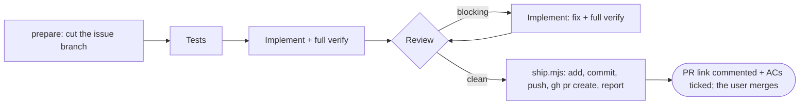

# Workflow

How features get designed and built (ADR-024). A spec is a GitHub issue on the **FinMel project** — never a file in the repo.

## The board

| Field / label | Values | Set by |
|---|---|---|
| Status (built-in) | Todo → In progress → Done | `/design` and `/fix` publish at Todo; `/build` sets In progress; `prepare` cuts the branch with `gh issue develop`, so it is the issue's linked branch and merging its PR closes the issue and the project's "Item closed" workflow sets Done |
| Tier | 1, 2 | `/design` / `/fix`; `/build --tier` overrides for one run |
| Kind | New, Change, Cleanup, Fix | `/design` / `/fix` |
| Branch | `feat/<slug>`, `fix/<slug>` (none on an epic) | `/design` / `/fix` |
| labels | `spec` (buildable), `epic` (umbrella of a split — its sub-issues are built, never the epic), `skip-tests`, `e2e` (an epic's last part, or an own-plan e2e part of a coverage epic, see "The e2e part"), `autobuild` (built unattended by `autobuild.mjs`; an In progress item without it is a manual build, `ręczny`) | `/design` / `/fix` |

**The queue.** The Todo order on the board is the build queue: top-level items (no parent epic, not Done), In progress first, then Todo in board position. Keep the board view unsorted so a dragged card stays where it is dropped. `gh-project.mjs queue` prints it as JSON, `move <n> top|bottom|before:N|after:N` places a card, `create --queue <position>` places a new top-level item (default `bottom`; `/design` proposes the position, `/fix` issues go to the bottom) and a created part lands right after the previous part. `prepare` moves a part's epic to In progress together with its first part; the epic goes Done at the end of `autobuild.mjs`, or by hand.

**Epics.** Either `/design` or `/fix` — at your request or on its own proposal, at any point of the interview or diagnosis — can split the work into an `epic` with one sub-issue per part. Each part is a full spec with its own tier, kind, branch and ACs, and leaves master green when it merges. Parts are attached in build order and built in that order: `prepare` refuses a part while an earlier sibling is still open, because every branch is cut from master. An already published spec becomes a part with `edit <n> --parent <epic>`. GitHub never closes the epic itself — `plan-status` flags it once every part is Done.

Every board operation goes through `scripts/gh-project.mjs` (`init`, `check`, `create`, `edit`, `get`, `list`, `queue`, `move`, `set`, `prepare`, `report`, `comment`, `tick`) — the one place that knows the project number and its fields. Its reads and writes are narrow GraphQL queries (`get` 1 point, `list` ~2, `set` 3, never `gh project item-list`), and every script spawns `gh` only through `scripts/gh.mjs`. `/board` shows the queue; the `SessionStart` hook shows git alone (`plan-status.mjs --no-gh`, no GitHub call); run `plan-status.mjs` by hand for the live spec table.

## Agents (`.claude/agents/*.md`)

| Agent | Model / effort | Tools | Preloaded skill | Job | Returns |
|---|---|---|---|---|---|
| `implementer` | Tier 1: sonnet/medium; Tier 2: sonnet/high; Tier-1 skip-tests cleanup: haiku/high — escalating once per run to opus/medium (Tier 1) or opus/high (Tier 2); later calls (review fixes) stay escalated | Read, Edit, Write, Glob, Grep, Bash + microsoft-docs, context7, LSP — no `Agent` | `backend-playbook`, `frontend-playbook` | drives tests to green per the spec, owning the design and the tests: fixes a wrong test or a wrong design decision itself and lists each in `deviations` (the reviewer judges each, the run report lists them); updates `requests/*.http`, the TS client, and any rule/ADR it changes the convention of. Runs filtered `dotnet test` while working, then the **full** verification itself before returning: `verify.mjs --all --fix --cache --out .git/verify-result.json --detach` (returns at once, the run continues on its own), waited on with `--await` (≤ 55 min per call, repeated while `VERIFY_PENDING`); up to 3 fixes in its own context, still red -> `verified: false`. Bash `timeout: 600000` on `dotnet test`, `3600000` on `--await` | `{status, verified, failures[], filesTouched[], projects[], commandsRun[], notes[], deviations[], openQuestions[]}` |
| `e2e` | sonnet/medium (Tier 1) or sonnet/high (Tier 2), escalating once to opus; runs only in an e2e part, instead of the test-writer and implementer | Read, Edit, Write, Glob, Grep, Bash + context7 — no `Agent` | — | automates the epic's `## Test manualny` 1:1 as `e2e/tests/<epic-slug>.spec.ts` (one `test.step('Krok <n>: …')` per plan step, `(tylko manualnie)` for a step it cannot automate) - or, in an own-plan part (`ownPlan`), the spec's own `## Test manualny` into the file its Goal names - refreshes the plan (the epic's, or the part's own in `<n>.manual.md`), runs `verify.mjs --projects e2e` and the whole suite through `e2e.mjs run --detach`/`--await`, classifies each failure; edits only `e2e/` and the plan file | `{status, verified, filesTouched[], notes[], deviations[], manualTest[], e2e{passed,total,flaky[]}, blocked{class: app\|environment, failed[{test,step,trace}], reportPath, selfCheck}}` (before an `app` block it runs a 30 s self-check) |
| `test-writer` | haiku/high (Tier 1); sonnet/medium (Tier 2) | Read, Edit, Write, Glob, Grep, Bash + microsoft-docs, context7 | `testing-playbook` | writes failing tests from the spec's acceptance criteria (slice/unit/tenancy/outbox), runs them **filtered** to confirm red | `{tests[{name,file,ac}], projects[], contextFiles[]}` |
| `reviewer` | round 1: opus/medium (Tier 1) or opus/high (Tier 2); round 2+: opus/medium narrow re-review | Read, Grep, Glob, Bash + microsoft-docs, context7 — no Edit/Write | `review-checklist` | fresh context; reads the uncommitted change through `scripts/review-diff.mjs` against the spec and the hard rules; flags only what breaks correctness or an acceptance criterion. A re-review gets the previous blocking findings plus the fix's notes, deviations and `filesTouched`, checks each is resolved and that those files broke nothing, and does not re-run tests to confirm green | `{findings[{severity: blocking\|minor, file, line, claim, evidence}], summary}` |
| `ops` | sonnet/medium | Bash, Read, Edit, Write, Glob, Grep + GitHub MCP (reads + review comments only) | `ops-playbook` | `/ops` chores only: commits, PRs, CI triage, dependabot, runner, `.github/**` — never a merge | `{branch, commit?, prUrl?, notes[]}` |
| `Explore` (project agent, `.claude/agents/explore.md`) | haiku/medium | read-only | — | codebase research for `/design` and `/fix` | text |
| `idea-critic` | sonnet/medium | Read, Grep, Glob — read-only, no Bash | — | fresh-context devil's advocate for an `/idea` prompt: gaps, ambiguities, hidden assumptions, contradictions with ADRs / product "Out of scope" / issues, scope creep or a missing split, questions the user could answer now | ≤ 8 lines `type \| quote \| why \| fix \| needs-user`, or `none` |

Author ≠ reviewer (ADR-024): the reviewer always runs in a clean context and never edits a file.

**Documentation access:** .NET 10 and Angular 22 are newer than any model's training data, so the agents that write or judge code reach the doc servers themselves — microsoft-docs for .NET/ASP.NET/EF, context7 for Angular/Material/MassTransit. `ops` holds GitHub MCP for reads and PR review comments only; the `git-guard` hook sees `Bash` alone, so every repository state change stays on `git`/`gh`, and no agent has a merge tool.

## Pipeline — `/build #<issue> [--tier 1|2] [--skip tests,review] [+Nk]`

- **Branch first (D1).** `gh-project.mjs prepare` cuts the issue's branch from an up-to-date `master` (it always runs `git fetch origin` and fast-forwards local `master` to `origin/master` first, so `master...HEAD` diffs are correct; then `gh issue develop … --checkout`, or `git switch` when it exists) before the card moves and before a single file is written. A dirty tree stops it with `{ok:false, stage:"branch", reason, files, next}`. An interrupted run therefore leaves its work on its own branch, never loose on `master`, and re-running `/build #<n>` picks that branch back up.
- **Review reads the uncommitted change (D2).** Nothing is staged or committed before the review. `node scripts/review-diff.mjs --stat` lists the change, `-- <path>` shows a file's diff (untracked new files included), no argument shows everything; the index is never touched.
- **The pipeline ships, the user merges (D3).** The workflow returns `status: "ready"` (or `"blocked"`) plus `nextCommand`, always `node scripts/ship.mjs <issue> --from-run` (first in the result), which `/build` runs as one Bash call right after the workflow, with no build, test or diagnostics check in between. The run report travels in the result's `ship` field (`{ report, blocked }`); `--from-run` reads it, with the branch and title, from the newest `build-feature` run record of the issue (`build-replay.mjs` `latestRunRecord`), so a truncated workflow result never loses it. `--branch … --title … --json '…' [--blocked]` stays for a hand-made ship. `ship.mjs` guards the lane (feat/fix/chore, never `master`), runs `verify.mjs --all --cache-check` (a cache miss blocks the ship: the tree was not proven green), then `git add -A`, commits (the spec's title, `Spec: #<n>`, the co-author trailer), `push -u`, `gh pr create --base master` (or reuses the open PR), then posts the run report via `gh-project.mjs report`. When the implementer returned `manualTest` (`[{issue, file}]`), a shipped report also replaces the `## Test manualny` section of each named issue with that file (`gh-project.mjs section`) and adds `Test manualny zaktualizowany w #<n>` to the comment: the part's plan is rewritten when the build deviated from it, and the build of an epic's last part (`prepare` sets `workflowArgs.epic.last` and writes the epic and sibling bodies to `skarbiec-plan/issues/`) always refreshes the epic's whole-feature plan. The reviewer blocks a plan that names a route, screen or action absent from the code. A failure posts a blocked report (stage `ship`); `--blocked` only posts the report and never touches a plan. Its last stdout line is `SHIP_RESULT: {"ok","branch","commit","prUrl","reportPosted","failedCommand"?,"error"?}` (exit 0/2). No agent merges; the one exception is `scripts/autobuild.mjs` (see "Unattended queue run").
- **A running stack never blocks a run (D4).** The local stack (Aspire AppHost, services, `ng serve`) locks build outputs and `node_modules` binaries. `verify.mjs` stops it itself on MSB3021/3026/3027 and retries the build; any agent blocked by it (locked file, port in use) runs `node scripts/stop-stack.mjs` and retries once. Nothing restarts the stack — that is the user's. The one stack an agent may start and stop is the isolated `skarbiec-e2e` compose project, only through `node scripts/e2e.mjs` (ADR-034).
- **Preflight before `prepare`.** `/build` and `/fix` run `node scripts/preflight.mjs` before `gh-project.mjs prepare`, so a missing prerequisite stops the run before the card moves. It fixes what it safely can — starts Docker Desktop and waits for the daemon, stops a running stack (`stop-stack.mjs`), runs `npm ci` in `web/` when `node_modules` is missing or older than `package-lock.json` — and only reports what needs the user: Node/.NET SDK versions, `gh` login and token scopes (`repo`, `project`), the git remote. `--dry-run` never changes anything; `--no-web` skips the npm check.
- **Implementer red:** it makes up to 3 fixes in its own context; still red (or blocked) -> exactly one escalation per run: a fresh implementer on the escalated level (Tier 1 sonnet/medium or haiku/high -> opus/medium; Tier 2 sonnet/high -> opus/high), given the previous failures, notes and deviations and the tree on disk, also with 3 fixes. If it fails too, the run stops `status: blocked` at stage `implement`. After escalating, later implementer calls (review fixes) stay escalated.
- **Review has `blocking` findings:** the implementer addresses them through the same attempt + escalation path and re-verifies fully; the reviewer then re-reviews narrowly (opus/medium); up to `maxRounds` (2) review rounds, else `status: blocked`. `minor` findings never block the run — they come back in the workflow result, and `/build` prints them; `ship.mjs` posts them on the issue.
- **Skippable phases.** `Tests` and `Review` can be skipped; the implementer's full verification never — it is the definition of green. A spec issue carries the `skip-tests` label when it adds and alters no behaviour (deletion, config, docs, a pure move); every acceptance criterion must then be provable by a command, a grep or an existing test class. `/build --skip tests,review` overrides the label for one run. A spec **without** the flag whose test-writer produces nothing still stops the run — that means its criteria were not testable as written, which is worth knowing.
- `/build` is a skill with `disable-model-invocation: true` that calls `Workflow({name: 'build-feature', args})`: control flow is a script (`.claude/workflows/build-feature.js`), not model tokens. `/build` first writes the issue body to a gitignored local copy (`skarbiec-plan/issues/<n>.md`, via `gh-project.mjs get --out`); each agent receives that path, the branch and title, and the prior phase's structured output — never the conversation history or a raw diff.
- **Loose ideas go through `/idea` first** (optional). An Opus/high session turns a loose idea or bug report into a product-level prompt: `scripts/idea.mjs context` gives it a digest (app map, board, ideas, ADR titles, out of scope) instead of reading the docs, it interviews and challenges the idea, makes at most one `Explore` call, then the `idea-critic` (Sonnet) reviews the draft. The output is one file per change in the main checkout's gitignored `skarbiec-plan/prompts/`, copied to the clipboard by `idea.mjs check`; `/design idea:<slug>` (or `/fix idea:<slug>`) reads it, keeps its decisions settled, and marks it `used` once the issue is published.
- **How to run.** `/design` and `/fix` in an Opus session (fresh is best: `/clear`). `/build` in a fresh session or `claude --model haiku "/build #<n>"`: a skill whose `model:` differs from the session model re-reads the whole history uncached, twice (there and back), and a subagent cannot call the `Workflow` tool, so `/build` cannot be forked.
- `+Nk` sets a token budget checked before every phase; going over it returns `status: blocked` with a report, never a silent partial run.
- `resumeFromRunId` resumes a run inside the same session; across sessions, re-running `/build #<n>` on the existing branch is the recovery path.
- **Resume replays finished steps.** When `prepare` finds its issue branch already checked out with a dirty tree, `scripts/build-replay.mjs` reads the newest `build-feature` run of that issue from the Claude Code history (`projects/<repo path>/<session>/subagents/workflows/<run>/journal.jsonl`, plus the run record `workflows/<run>.json` once the run finished) and `prepare` writes a gitignored `skarbiec-plan/issues/<n>.resume.js` (the workflow with its `// @replay` line filled in); `/build` calls `Workflow` with that `scriptPath`, so `step()` returns each recorded result in order without an agent call and only the first unfinished step runs live (told that its partial changes are on disk). End rule: no record (interrupted), `ready` and a `budget` block replay every finished step; a block at `implement` or `review` replays all but the step that blocked; a block at `tests`, `input` or `e2e` replays nothing. A label that no longer matches, a changed tier/skip/e2e, a spec body that differs from the last run's, or `--fresh` falls back to a normal run. `<n>.run.json` (`bodyHash`, args, `replayed` steps, `writtenAt`) lets a run launched from a resume script, whose journal only holds its live steps, be prefixed with the steps its predecessor replayed. `node scripts/build-replay.mjs <issue> [--history <dir>]` shows what a resume would do.
- **The e2e part.** Every epic whose change is visible in the app ends with a part labelled `e2e` (`create --e2e --parent <epic>`, tier 1, kind new, from `.claude/skills/design/e2e-part-template.md`, four fixed ACs, no `## Test manualny` of its own). An e2e coverage epic (tests for features that already exist) is instead a sequence of **own-plan** e2e parts, one per area, each with its own numbered `## Test manualny` and the own-plan variant of the template; the umbrella holds no plan and gets no trailing e2e part. `prepare` emits `workflowArgs.e2e` (and `ownPlan: true` for an e2e part whose body has a numbered `## Test manualny`; the workflow then automates that plan into the spec file its Goal names and refreshes `<n>.manual.md` for the part's own issue instead of the epic's), and for an e2e part whose branch has no commits ahead of `origin/master` it recuts the branch from `origin/master`. `build-feature.js` then runs **e2e → review** (no test-writer, no implementer): the `e2e` agent writes the tests from the epic's plan, refreshes it (`manualTest`), runs `verify.mjs --projects e2e` and the whole suite, and classifies every failure — test or harness code (fixed, up to 3 rounds), flaky (green, listed in the report), environment (blocked, class `environment`), stable app failure (blocked, class `app`, with the test, its `Krok <n>`, the trace and report paths and `blocked.selfCheck`). Before an `app` block the agent runs a **self-check**, once per failing test: it rewrites the failing assertion with `expectProjected` (`e2e/tests/projection.ts`, 30 s, re-fetches before every attempt) and reruns only that test with `e2e.mjs run --grep`; green means a test defect (the rewrite stays, one test-code round), red blocks as `app` and the block comment prints `- self-check: …`. A Reporting projection value is asserted with `expectProjected`; a `toPass`/`expect.poll` on it without a re-fetch is forbidden. The reviewer blocks an unmapped plan step, an assertion that differs from the plan, any changed file outside `e2e/`, a new `test.skip`/`test.fixme`/`waitForTimeout`, a new `toPass`/`expect.poll` on a projection value without a re-fetch and a weakened existing test. `ship.mjs` gates an e2e part on `verify.mjs --projects e2e --cache-check` plus `node scripts/e2e.mjs check` (a green, whole-suite `.git/e2e-result.json` with the fingerprint of the tree about to be committed); the report line is `**e2e:** <passed>/<total> green` plus the flaky tests. A block at stage `e2e` commits nothing: `ship.mjs --blocked` posts `**Blocked** at \`e2e\` (app|environment)`, saves the uncommitted diff to the gitignored `skarbiec-plan/issues/<n>.e2e.patch`, restores the tree and switches to `master`, so `/fix` starts clean. After the fix merges, `/build #<n>` (or `autobuild.mjs`) recuts the branch from master and the agent writes the tests again; the patch is for reference, except after an **E2E test defect** diagnosis (below): then `prepare` applies it.
- **Bugs go through `/fix <bug>`**, not a hand patch: it reproduces first, localizes the root cause (with `Explore`), publishes a `Fix`-kind issue on `fix/<slug>` whose AC-1 is the reproduction test (or, for several root causes or a fix that must land in sequence, an epic of such issues, building the first), and after approval runs the same `/build` steps — so a fix gets the same test-writer → implementer → reviewer path as a feature, and the diagnostician never reviews its own fix.
- **Changes to existing behaviour go through `/design`**, not `/fix`: a bug is code failing its own intent, a change is the intent moving. `/design` sends `Explore` after the current implementation first and records it under "Current behaviour" in the spec. A spec that needs fixing is amended in place (`gh issue edit`), never duplicated.

## Unattended queue run — `node scripts/autobuild.mjs [<n>]`

A script the user launches from a terminal (not an agent) drains the build queue (`gh-project.mjs queue`: top-level not-Done items, In progress then Todo, board order) item by item: a fresh headless `claude -p "/build #n" --model haiku --permission-mode auto` per part, then it waits for green CI on the PR, squash-merges it (`--delete-branch`), syncs `master` and moves on. An item is an epic (its open parts in order, then the epic is closed and set Done) or a standalone issue (built like a one-part epic). It is the single place where something other than the user merges.

- **Plan:** the queue is read once at the start and the plan is fixed; before each item its state is re-read (a closed one is skipped). `--items N|all` (default all) takes the first N items; an In progress item without the `autobuild` label is a manual build (`ręczny`) and is skipped unless `--include-manual`. `autobuild.mjs <n>` plans only `#n` - an epic or a standalone issue, manual or not; a part stops `usage` with `#n is a part of epic #m`, a Done item gives an empty plan. An empty plan ends `done` (`kolejka pusta`, no shutdown). Before a part's build `autobuild.mjs` adds `autobuild` to the item and the part, which also claims a manual item it was told to take.
- **Start and window:** `--start now|MIN|HH:MM` keeps the PC awake from launch and begins the work (preflight included) at that time (HH:MM = the next occurrence). `--until HH:MM` is the window end, the next occurrence after the start: no `claude -p` session (`/build` or `/fix e2e`) starts at or after it; one already running finishes, its CI wait and merge still run, then the run ends with reason `window`. `--max-tasks` counts builds across the whole run.
- **Needs:** a clean working tree (or uncommitted changes on the first item's next part's own branch with no open PR - an interrupted build, resumed; anything else stops `dirty-tree`), `preflight.mjs` passing, the WSL runner online (otherwise CI never starts - `runbooks/ci.md`), and each part's Branch field set. `--dry-run` prints the numbered plan (`ręczny` marked), the start time, the window end and per item's part what would happen (skip / CI → merge / build / resume build / retry ship / waits), and the runner, and changes nothing.
- **Test plan upkeep:** `autobuild.mjs` never reads or writes an issue body (only its e2e repair, below, may rewrite the epic's plan). Each part's `/build` updates its own `## Test manualny` on deviation, and the last part's build (every other sub-issue closed) refreshes the epic's plan, exactly as a manual `/build` does.
- **Resume:** there is no state file. Every iteration re-reads the epic from GitHub: a CLOSED part is skipped, a part with an open PR goes straight to CI + merge, otherwise it is built. An interrupted build is built again on the tree on disk (`/build` continues from the existing changes, the pipeline reruns from tests). If the newest comment on the part is a blocked report at `ship` and HEAD is its branch, only `ship.mjs` is retried (not counted as a build). A build session that ends with no PR, no new comment on the part and a `ready` workflow run newer than the build start (the relay never ran `nextCommand`; ship.mjs comments on every run) is shipped by `autobuild.mjs` itself with `ship.mjs <n> --from-run`. Re-running the same command after any stop continues where it stopped.
- **The e2e part in an unattended run:** it is built like any part. When the newest comment on it is a blocked report at `e2e`, the plan is a fresh `build` (the tree was cleaned and `prepare` recuts the branch from master); a build that ends blocked at `e2e` is repaired without the user. `environment`: `stop-stack.mjs`, then the e2e part is rebuilt once per run. `app`: a headless `claude -p "/fix e2e:#<n>" --model claude-opus-5-5` reads the block, reproduces below the browser and decides which side is wrong - the app (it publishes `Fix:` part(s) with `create --parent <epic> --before <n>`, so the loop builds, CI-checks and merges them before rebuilding the e2e part) or the epic's plan (a part's AC specifies what the app does; it rewrites those steps of `## Test manualny` and comments the epic) or the test (through the API and after a reload the app reaches the plan's value within 30 s, and the test waits wrongly, does not re-fetch or selects wrongly) - and ends with a `FIX_RESULT:` line (kind `app`, `plan`, `test` or `stop`). For `test` it changes no file and comments the part with a diagnosis whose first line is `**E2E test defect** — <test>, Krok <k>` (what is wrong, the evidence, the fix hint; never a changed expected value). The diagnosis is the part's newest comment, so the next build of the part - from `autobuild.mjs` or a manual `/build #<n>` - reads it: `prepare` writes it to `skarbiec-plan/issues/<n>.diagnosis.md`, applies the saved `<n>.e2e.patch` (after `git apply --check`) onto the fresh branch and passes `workflowArgs.diagnosis` and `patchApplied`; the e2e agent then fixes only how the diagnosed steps wait, re-fetch or select, and the reviewer blocks a changed expected value or plan assertion compared with the patch. A value that never arrives, arrives after more than 30 s or differs from the plan is `app`. An unknown `FIX_RESULT` kind stops the run (`blocked`). The run stops with reason `e2e app` / `e2e environment` and the trace path when the repair stops (no reproduction, a missing design, a harness cause), after the 3rd app block on one part - `app`, `plan` and `test` repairs share that one limit - or on a second environment block in the run.
- **Stop reasons** (the epic gets a comment with the parts done, the reason and the detail; exit 2 except `done`): `done` (every part merged; the epic is closed and its card set to Done), `stopped` (stop file), `max-tasks`, `window` (the `--until` time passed - no new build), `e2e app` / `e2e environment` (the e2e part is blocked), `limit` (`--on-limit exit`, or the limit hit during an e2e repair), `limit-unknown` (the build hit the Claude usage limit and its stream carried no reset time), `limit-too-far` (the reset is beyond `--max-wait`, e.g. the weekly limit), `wake-not-ready` (after the limit wait the PC was not ready within 15 min), `blocked` (the build opened no PR - its report is on the issue), `timeout` (build over 4 h), `ci-failed`, `ci-missing` (no checks after 10 min), `ci-timeout` (90 min), `ship-failed` (the retried ship step failed again), `merge-failed`, `sync-failed`, `no-branch`.
- **GitHub budget:** CI is polled over REST (the PR head's check runs; a failed read is logged, never counted as "no checks"), the project is read over GraphQL. The log has a `GitHub: GraphQL <remaining>/<limit>, REST <remaining>/<limit>, reset HH:MM` line at the start and end of each part (and in `--dry-run`); `prepare` stores the start snapshot in `.git/gh-usage-start.json` and the run report carries one line with it and the snapshot at report time.
- **GitHub limit:** `scripts/gh.mjs` classifies a failed `gh` call (`primary-graphql`, `primary-rest`, `secondary`, `transient`, `other`; unclear text counts as primary when `rate_limit` shows that resource at 0). `autobuild.mjs` is the only script that waits, with no upper bound: it logs `limit GitHuba (<kind>), czekam do HH:MM`, sleeps until the reset plus 30 s (a secondary limit: 60 s doubling to 15 min), logs the resume and repeats the same call or step. A `/build` stream carrying a `GITHUB_LIMIT` line (a script inside it exited 4) or a `ship.mjs` exit 4 is waited out and the step rerun (the workflow journal replays what the build finished). The wait counts towards neither the build nor the CI timeouts, and the heartbeat keeps logging. Before a write is repeated after a wait it is checked: a merged PR is not merged again, a closed issue not closed again, the run summary and the build report (hidden `skarbiec-run` marker: issue, branch, head, report digest) not posted twice. The Claude usage limit is a separate wait (below). Interactive scripts (`gh-project.mjs`, `ship.mjs`, `gh-usage.mjs`) never wait: they print `Limit GitHuba (<kind>) wyczerpany, reset o HH:MM` and a `GITHUB_LIMIT` line on stderr and exit 4; `plan-status.mjs` and `idea.mjs context` print `limit GitHuba do HH:MM` in place of the board.
- **Start wizard:** when stdin and stdout are a terminal (`--dry-run` too), `autobuild.mjs` asks every setting no flag answered, in order: the plan (the numbered queue, `--items`, skip manual items - only when the plan has one), the limit behaviour (`--on-limit`, with the wake-timer state, option a) marked unavailable with the hint when timers do not work; then `--max-wait`), shutdown after the run, the start (`--start`) and the window (`--until`). A flag (or the positional number, for the plan) skips its question; Enter takes the shown default; an invalid answer is explained and asked again. Then it prints a summary (with the resolved start and window end date and time), the equivalent command and one `Start? [T/n]` (none when no question was asked). `n` exits 0 and Ctrl+C exits 130; either way nothing starts - no log, keep-awake, comment or shutdown. Without a terminal nothing is asked and the defaults apply. Code: `scripts/autobuild-wizard.mjs`.
- **Stop it:** `node scripts/autobuild.mjs --stop` (a number is ignored) creates the one stop file `%TEMP%/skarbiec-autobuild.stop`; the driver finishes the part in flight and stops before the next build. Ctrl+C kills the build's process tree at once (exit 130, no comment, no shutdown).
- **Logs:** one plain-text file per run, the gitignored `skarbiec-plan/autobuild-runs/<YYYYMMDD-HHMMSS>.log`, with exactly the lines the terminal shows (`HH:MM  ` + event: phase, agent type and model, start/done with tokens and time, background commands, CI, merge, a `still:` line after 10 quiet minutes). The raw stream is not kept; each build prints its session id, and `claude --resume <session>` opens the full conversation. `--permission-mode auto` can deny a tool call without anyone to answer: that prints `DENIED: <tool>` and the build's last line counts the denials.
- **Power:** on Windows a hidden PowerShell child holds `SetThreadExecutionState` (`ES_SYSTEM_REQUIRED | ES_DISPLAY_REQUIRED`) from launch while the run lasts, so idle sleep, display-off and the idle lock are blocked; closing the lid still sleeps the PC. `--start` holds the PC awake from launch but starts the work only at the given time, logging the start time and a line every 10 min; the stop file ends the wait (reason `stopped`, no comment, no shutdown), and so does Ctrl+C. Every sleep, hibernation and end-of-run shutdown is announced by an always-on-top Tak/Nie popup (`Uśpienie|Hibernacja|Wyłączenie za 9:41`, counting down 10 min): **Tak** acts at once, no answer acts when the 10 min run out, **Nie** declines (the PC stays on; a declined sleep is an awake wait). Unless `--no-shutdown` (`--shutdown` is the default) or `--dry-run`, every end of the run, whatever the reason, asks `Wyłączenie za` and then runs `shutdown /s /t 0`.
- **Claude usage limit:** a build's own stream reports the limit and its reset (nothing probes it). `--on-limit sleep|wait|exit` (default `sleep`) and `--max-wait <hours>` (default 12) decide: the wake time is the reset + 5 min; with `sleep` a wait of 15 min or less is awake, under 1 h the PC is suspended, from 1 h it hibernates (suspended when hibernation is unavailable, awake when wake timers are off); `wait` always waits awake; `exit` ends the run with `limit`. An unknown reset ends `limit-unknown`, a reset beyond `--max-wait` `limit-too-far`, and a wake time at or after the `--until` window end ends `window`, all without sleeping. The log says `limit Claude, reset HH:MM — hibernacja do HH:MM` / `uśpienie do HH:MM` / `czekam do HH:MM`. A suspend or hibernate runs a hidden PowerShell with a waitable timer with resume (`powercfg /waketimers` needs admin and is never used), so nothing stays registered if the run dies; the 10-min popup counts towards the wait. After the wake or wait the stop file ends the run (`stopped`), a passed window ends it (`window`); then the PC must be ready - `preflight.mjs`, a `gh` call (the runner list) with the runner online - retried every 30 s for up to 15 min, still failing ends `wake-not-ready`. The same part is then built again (the workflow journal replays what the interrupted build finished); that rebuild does not count towards `--max-tasks`. Wake timers on mains power must be on (`powercfg /query SCHEME_CURRENT SUB_SLEEP RTCWAKE`, AC index 1); the first log lines say `wake timers: on` or `off — <hint>` with the `powercfg /setacvalueindex SCHEME_CURRENT SUB_SLEEP RTCWAKE 1` fix. Check the machine with `node scripts/autobuild.mjs --sleep-test <minutes>` / `--hibernate-test <minutes>`: it suspends or hibernates with a wake timer that many minutes ahead (no popup), prints the planned and actual wake time and `powercfg /lastwake`, and exits.
- **Last lines:** `run: <reason> — <detail>`, the items and parts done in this run (PR, build and CI minutes), `resume: <command with the run's flags>` unless the run is done, and the shutdown notice. The summary comment is posted on every item the run touched. Exit 0 when done, 2 otherwise, 130 on Ctrl+C.

## Definition of Ready (before `/build` will accept a spec)

- An open issue on the project with the `spec` label, Status Todo (or In progress for a resumed run), and a Branch — publishing it at all means you approved it in `/design`.
- Every acceptance criterion is a checkbox that names a test or a command that proves it.
- Tier is set (1 or 2).
- `skip-tests` is set deliberately — only on a spec that changes no behaviour.
- No open question left in the body.
- A change visible in the app has its `## Test manualny` section (see Manual test plan).

## Manual test plan

The steps a person runs by hand after a merge, to confirm the feature works. A spec whose change is visible in the app
ends with `## Test manualny`; an epic holds the whole-feature scenario in the same section. `/design` writes it, `/fix`
writes the reproduction steps.

- **Skip** it only when the change is not visible in the app: `skip-tests` specs, cleanups, workflow specs. Then the
  section is absent, and `gh-project.mjs check` warns about it without failing.
- **Size:** a part plan about 5–15 steps; an epic's scenario about 15–30 steps, from an empty account to the final state.
- **Shape:** a numbered **Przygotowanie** block (the standard preparation below, plus what the change adds), then
  numbered **Kroki** on concrete PLN amounts, dates, tickers and routes, each ending in `→ <expected result>`. Write
  the steps in Polish. Describe behaviour, not exact labels, unless the label is an acceptance criterion.
- **A part with no UI effect of its own** carries only the line `Weryfikacja w planie epica, krok <n>.`
- **Checked by `gh-project.mjs check`:** a `- [ ]` or `- [x]` line in the section is an error, and so is a section with
  neither a numbered step nor the one-line marker.

**Standard preparation** (the start of every plan):

1. Pull `master`, then `node scripts/compose.mjs build` and `node scripts/compose.mjs up` (`status` shows whether the
   running stack is outdated).
2. Wait about 3 minutes after `up`: the FX sync runs on a 3-minute cron, so rates appear only after its first run.
3. Use a fresh account at `http://localhost:8080` (the compose app port).

**Market data facts** a plan can rely on:

- The seeder adds, on every startup, the instruments gold `XAU` and silver `XAG` (per gram of fine metal, GoldApi), `CDR.WA`
  (CD Projekt, GPW, PLN) and `VWCE.DE` (Vanguard FTSE All-World, Xetra, EUR), plus the currencies PLN, EUR, USD, GBP, CHF.
- Prices sync on a 2-minute cron. After a holding is added, the sync button on Settings pulls its price at once instead of
  waiting for the cron.
- The bond catalog fills at startup when it is empty, so bond series exist right after `up`.
- FX history covers 365 days. A transaction dated earlier has no rate; a stock or ETF Buy/Sell then fails with
  `Validation.FxRateMissing`.

## Definition of Done

- `node scripts/verify.mjs --all` is green, run by the implementer; `ship.mjs` re-checks it with `--cache-check`. For an e2e part: `verify.mjs --projects e2e` and the whole e2e suite (`node scripts/e2e.mjs run`) green on the committed tree, no production file changed; `ship.mjs` re-checks both.
- Review has zero `blocking` findings.
- The whole change is committed on the issue's branch, pushed, and its PR against `master` is open.
- The run report, with the PR link, is commented on the issue and its acceptance criteria are ticked.
- Any rule or ADR the spec touched is in the same commit.
- The user merges the PR when CI is green — which closes the issue and moves the card to Done (in an unattended autobuild run, `autobuild.mjs` merges it).

## Tier rule

| Tier | When | Starting model |
|---|---|---|
| 1 | well-scoped and mechanical, low ambiguity (e.g. spec-00, spec-01, spec-05, spec-06) | test-writer haiku/high, implementer sonnet/medium (a skip-tests cleanup: haiku/high), escalating once to opus/medium; reviewer opus/medium |
| 2 | changes the data model or event contracts; acceptance criteria must close a real behavioral gap (e.g. spec-02, spec-03, spec-04) | test-writer sonnet/medium, implementer sonnet/high, escalating once to opus/high; reviewer opus/high |

`/design` sets the tier when it writes the spec; `/build --tier` overrides it if the estimate was wrong.

## Budgets and escalation

No budget is enforced by default — a `/build` run goes to completion. Passing `+Nk` caps tokens for that run; `budget.remaining()` is checked before every phase, and running out stops the pipeline with `status: blocked` rather than continuing silently or truncating a phase mid-way. Escalation happens at most once per run, only toward a stronger model (haiku/sonnet -> opus), never back down, and only after a real failure — an implementer still red after its 3 fixes — never pre-emptively.

## Git conventions

- Branch: the issue's Branch field — `feat/<slug>`, or `fix/<slug>` for a fix — cut by `gh-project.mjs prepare`.
- Commit message: the spec's title, a `Spec: #<n>` line and the co-author trailer — made by `ship.mjs`.
- PR: opened by `ship.mjs` against `master` from the issue's linked branch — no `Closes #<n>` needed. **The user merges — no agent merges; the one exception is `scripts/autobuild.mjs`, which the user launches from a terminal.**
- No agent runs a git mutation in a build run (`/build`, `/fix`): `prepare` cuts the branch and `ship.mjs` commits and pushes. Otherwise only `ops` inside an explicit `/ops <task>` that asks for it.
- `git-guard` hook: commit/push on `feat/*`, `fix/*`, `chore/*`, and `gh pr create --base master` from those, run without asking; `gh pr merge` always asks; a push to `master` asks; a force-push is denied outright. A prompt during the Ship step means a command left the lane — `ship.mjs` refuses and posts a blocked report. Legacy lanes (`praca_*`, `[MT]\d`) keep whatever behavior they already had.

## Scripts vs. prompts

What can be a script or a hook is not a prompt (cheaper, deterministic, no drift):

| Concern | Mechanism |
|---|---|
| Verification (format, build, tests; `web/`: typecheck, lint, build, test; OpenAPI-client diff) | `scripts/verify.mjs` — one Node script usable from Bash, hooks and CI alike. Test projects run one at a time by default (`--jobs N` runs N at once alongside web, but parallel Testcontainers suites deadlock and time out on this machine), then the web block; every failure is reported, not only the first. Format is `dotnet format --verify-no-changes` scoped to the changed `.cs` files (the whole solution only when there is no changed-file list — `--all` without `--fix`, no master ref — or a formatting-config change: `.editorconfig`, `.globalconfig`, `*.props`, `*.targets`, `Skarbiec.slnx`). A failed test project is rerun once on just the failed tests (at most 10 names, not after a timeout, a Docker or a compile error); a project that fails with a Testcontainers infrastructure error (Ryuk, `DockerContainer` not found) gets one full-project rerun; tests that pass on the retry do not fail the run and are reported as `flaky` in the result JSON. A new run kills the previous one via `.git/verify.pid`. The implementer runs it once (`--all --fix --cache`); `ship.mjs` only checks the cache (`--cache-check`). Agents otherwise run nothing but `--filter`ed tests |
| Formatting | `format-on-edit` hook (`PostToolUse` on Edit/Write); `web/**` → prettier. Whatever slips through (`.cs`, files written from Bash, lint autofixes) is fixed by `verify.mjs --fix`, so a formatting slip never costs a model round |
| Verify that cannot hang | `verify.mjs` has a 120-min run deadline that kills the whole process tree; the implementer starts it with `--out .git/verify-result.json --detach` (an independent process, not a Bash background job that Claude Code would kill after 10 min) and waits with `--await` (≤ 55 min per call, Bash `timeout: 3600000`, repeated while `VERIFY_PENDING`); a run that died or passed its deadline reports `step: timeout` |
| Build prerequisites | a spec's `## Depends on` section; `gh-project.mjs prepare` refuses while a listed issue is open |
| Token accounting | `scripts/run-cost.mjs` — $ at list prices per run and per agent type: model calls, cache read/write, largest context, share of exploring Bash calls; `--sessions` = main sessions per command + Explore; `--timeline [--issue n]` = per-agent wall time, verify time and `dotnet test` time of the newest run |
| Orchestration | the `Workflow` script (`build-feature.js`) — zero model tokens spent on control flow |
| Board mechanics | `scripts/gh-project.mjs`: `check`/`create`/`edit` clean a draft (HTML comments, empty sections) and refuse one without Goal, Out of scope or a `proof:` per AC; `prepare` decides whether an issue is buildable, writes its local copy, resolves tier/skips, cuts or switches the issue branch (refusing a dirty tree before the card moves), moves the card and prints the exact workflow args; `report` formats and posts the run report and ticks the ACs. `scripts/review-diff.mjs` shows the reviewer the uncommitted change; `scripts/ship.mjs` guards the lane, commits, pushes, opens the PR and posts the report. So `/build` and `/board` run on Haiku as relays and no agent touches git in a build run |
| Plan status (which spec stands where, open PRs, rotting branches) | `scripts/plan-status.mjs`, derived from the project's spec issues + git + `gh`. A `SessionStart` hook injects its git half (`--no-gh`, no GitHub call) into every session, so no session ever starts from a stale README; `--write` refreshes the generated block in `skarbiec-plan/README.md`. Only "Open loops" there stays hand-written — that is judgement, not data |

## Cost per feature (API list prices: Haiku 5.5 $0.10/$0.50 per MTok up to a 100k prompt, $0.50/$2.50 above; Sonnet 5.5 $2/$10, Opus 5.5 $4/$20; cache reads 0.1x input - $0.20 on both Sonnet 5.5 and Opus 5.5; `opus` means `claude-opus-5-5`, pinned by full id)

| Stage | Model | Typical tokens | Cost |
|---|---|---|---|
| `/idea` (optional) | Opus, high (main session) + Sonnet medium critic | 20–60k | $0.1–0.4 |
| `/design` | Opus, xhigh (main session) | 30–80k | $0.3–0.8 |
| test-writer (skipped on a no-behaviour spec) | Haiku high (Tier 1) / Sonnet medium (Tier 2) | 40–100k | < $0.1 / $0.1–0.3 |
| implementer incl. full verification (Tier 1 / Tier 2) | Sonnet medium / Sonnet high; Opus medium / high on escalation | 100–300k | $0.2–0.6 / $0.5–1.5 (Opus: $0.3–0.8 / $0.8–2.5) |
| reviewer (skippable with `--skip review`) | Opus medium (Tier 1) / Opus high (Tier 2) | 40–100k | $0.3–0.8 |
| `ship.mjs` (commit, push, PR, report) | script | 0 | $0 |
| **Total per feature** | | | **~$1–2 (Tier 1), ~$2–5 (Tier 2)** |

The estimates above predate measurement. `node scripts/run-cost.mjs` over 29 runs (2026-09-24 → 10-02) found ~13.8M cache-read tokens per run, 51 % in the implementer and 39 % in the test-writer, half of their Bash calls exploring the code — hence the spec's `## Code map`, the agents' "Read cheaply" rules and the > 8 AC split signal. Re-run it for current numbers.

Measured 2026-09 (transcripts, list prices): Tier 1 averaged **$1.7** per run, Tier 2 (then opus/xhigh implementer + opus/high test-writer) **$6.9** (range $2–13) — implementer ~50%, test-writer ~30%, reviewer ~15%, Haiku phases < 2%. Cost splits roughly 45% cache writes (1h TTL = 2× input), 35% cache reads, 15% output: since cache reads cost the same on Sonnet 5.5 and Opus 5.5, moving a role to Sonnet saves ~30% of it, not 50%. The token counts above are per-call context, not totals — a run makes 60–230 calls.

Measured 2026-10-08 (#200, tier 2, old opus/high flow with a verifier): 89 min, $5.4 — ~58 min of it verification, ~25 min wasted by a Stop hook that ran after the agent had returned.

Every tier starts below Opus and escalates once: a green first attempt is cheaper, and the single escalation caps the cost of a miss.
